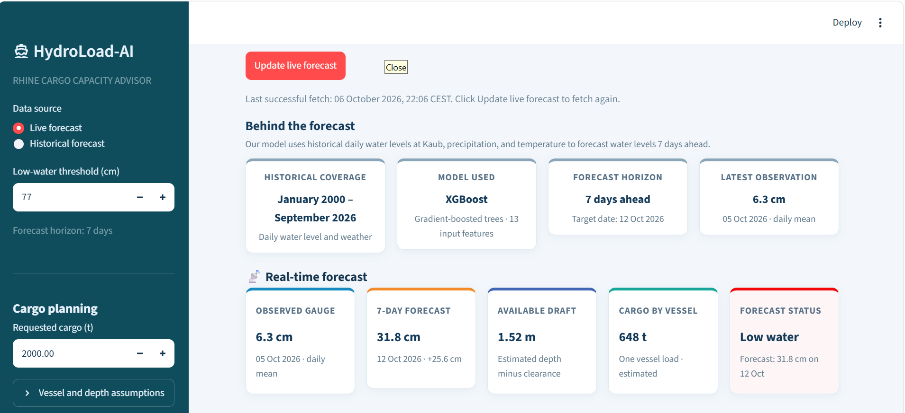

# 🚢 HydroLoad-AI — Rhine Cargo Capacity Advisor

Forecasts the Rhine water level at **Kaub** 7 days ahead and turns it into a barge
loading recommendation: will the level fall below the low-water threshold, and how
much cargo can one vessel still carry?



## Why Kaub?
Kaub is the shallowest point on the Middle Rhine. When the gauge drops, barges must
sail part-loaded and the remaining cargo moves to trucks — costly for shippers.

## Data
| Source | Content | Period |
|---|---|---|
| Kaub gauge | Water level, 15-min, in cm | 2000 – 2026 |
| Open-Meteo archive | Daily precipitation and temperature (50.08 N, 7.76 E) | 2000 – 2026 |

**Pitfall:** the gauge records Europe/Berlin local time (with DST), while Open-Meteo
returns a fixed UTC offset. Joining on printed timestamps misaligns the data for about
5 months a year, so `modeling/data_pipeline.py` converts both to UTC before joining
(covered by `tests/test_data_pipeline.py`).

## Approach
- Features: water-level lags (0–28 days), 3/7/14/30-day rain sums, 3/7-day mean temperature
- Baselines: persistence and a linear autoregressive model (notebooks 03–04)
- Final model: XGBoost regressor, 7-day horizon, served in a Streamlit dashboard

## Results
- At a 7-day horizon, **no model beats persistence at low water**: persistence has
  the lowest MAE in every regime below 150 cm.
- Linear models over-predict low water by ~45 cm, the dangerous direction for
  load planning; adding weather features halves that error.
- Lesson: report low-water error and missed alarms, not just overall MAE.

## Run it
```bash
make setup                                # install with uv
make data                                 # rebuild data/processed/
uv run streamlit run modeling/App.py      # start the dashboard
make test                                 # run tests
```

## Project structure
```
data/raw/         raw gauge and discharge CSVs
data/processed/   daily/hourly merged data (built by make data)
modeling/         data pipeline, real-time pipeline, cargo model, Streamlit app
models/           saved XGBoost model
notebooks/        01 import · 02 EDA · 03–04 baselines
tests/            timezone/join tests
```

## Limitations & next steps
- Gauge level is not navigable depth; vessel values in the app are examples.
- Add the upstream gauge at Bingen and discharge as features.

## Authors
Prithvi Hegde — neuefische Data Science Bootcamp
