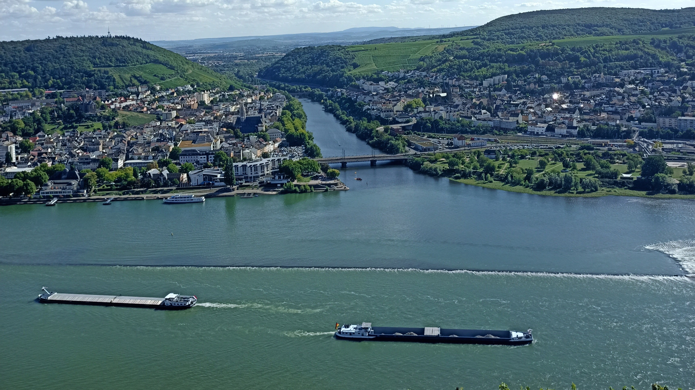
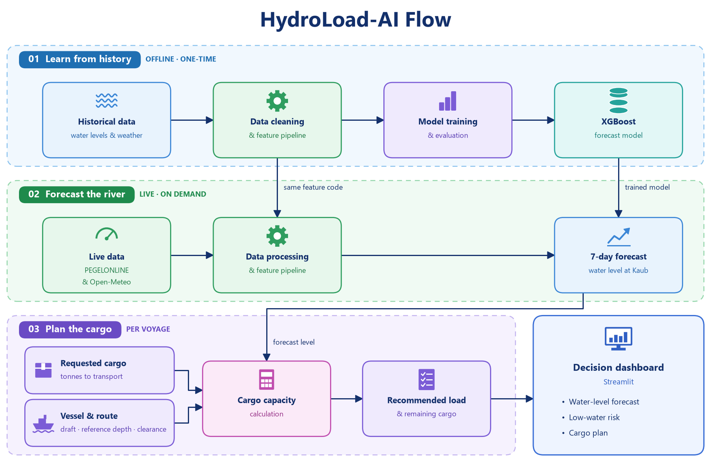

# 🚢 HydroLoad AI - <small><i>An AI Solution for Supply Chain management</i></small>


<sub>📷 Photo credit: Prithvi (taken near Kaub in summer 2025).</sub>

## Rhine water-level forecasting using ML algorithm and cargo planning

**A decision-support prototype that predicts the water level at Kaub seven days ahead and translates the forecast into estimated vessel cargo capacity.**

Developed by **Team Rhine-Riders** as a Data Science and AI capstone project at **neue fische**.

> **Project status:** Educational prototype. Forecasts and cargo estimates support scenario exploration; they are not certified navigation or loading instructions.

> **Documentation note:** This README reflects the project design and reported experiments. The repository is reflection of this document. It includes module,locations, dependency files, model metadata, and final evaluation values. The directory layout below is a suggested organization.

---

## Table of contents

- [Project overview](#project-overview)
- [Business problem](#business-problem)
- [Project objectives](#project-objectives)
- [Main capabilities](#main-capabilities)
- [How the system works](#how-the-system-works)
- [Data](#data)
- [Exploratory analysis](#exploratory-analysis)
- [Forecasting methodology](#forecasting-methodology)
- [Model evaluation](#model-evaluation)
- [Cargo-capacity estimation](#cargo-capacity-estimation)
- [Live data pipeline](#live-data-pipeline)
- [Streamlit application](#streamlit-application)
- [Technology stack](#technology-stack)
- [Repository organization](#repository-organization)
- [Installation and setup](#installation-and-setup)
- [Running the application](#running-the-application)
- [Reproducibility](#reproducibility)
- [Limitations](#limitations)
- [Future development](#future-development)
- [Team and acknowledgements](#team-and-acknowledgements)
- [License and data usage](#license-and-data-usage)

## Project overview

HydroLoad AI connects a machine-learning forecast with a practical logistics question:

**How much cargo could a vessel carry under the expected Rhine water-level conditions at Kaub?**

The project uses historical water levels(Gauge level), precipitation, and temperature to forecast the daily water level seven days ahead. A Streamlit application combines recent observations, a forecast, and vessel-specific cargo calculations in an interactive interface.

The cargo calculation uses the predicted gauge level together with a reference fairway depth, a clearance allowance, and vessel draft characteristics. Users can explore how different water levels and vessel assumptions affect estimated loading capacity.

The project demonstrates an end-to-end workflow: data preparation, feature engineering, chronological evaluation, model persistence, live inference, and an interactive application.

## Business problem

Shipping planners need to commit to cargo loads before the river conditions on the planned transport date are known. Low water can reduce the draft available to a vessel and therefore reduce the cargo it can carry.

For the project, Kaub is the focal gauge for examining this planning challenge along the Middle Rhine. Reduced loading capacity can mean more journeys, additional transport costs, delays, and a need to consider alternative transport arrangements.

HydroLoad AI aims to make the relationship between expected river conditions and estimated cargo capacity easier to explore.

### Intended users

- Shipping and transport planners exploring future loading scenarios.
- Logistics analysts investigating the effect of low water on transport capacity.
- Stakeholders evaluating the potential of forecasting in cargo planning.
- Data scientists studying environmental time series and decision-support applications.

## Project objectives

1. Prepare a consistent daily dataset from water-level and weather observations.
2. Explore seasonal patterns, extreme conditions, and relationships between variables.
3. Predict the Kaub daily water level seven days ahead.
4. Compare candidate models with a persistence baseline.
5. Evaluate forecasting errors on an unseen chronological test period.
6. Translate forecast water levels into approximate cargo capacity.
7. Display recent observations, predictions, and cargo scenarios in Streamlit.
8. Communicate assumptions, uncertainty, and limitations clearly.

## Project Flow


## Main capabilities

| Component | Purpose |
|---|---|
| Historical data analysis | Explore long-term water-level and weather patterns |
| Seven-day forecast | Forecast the water level seven days ahead |
| Model comparison | Compare regression and tree-based approaches with persistence |
| Live inference workflow | Prepare recent observations and generate a forecast using a saved model |
| Cargo calculator | Estimate loading capacity from vessel and depth assumptions |
| Interactive dashboard | Present observations, forecast information, and cargo estimates |

The core forecast is a **single value at t + 7 days**. It should not be interpreted as a separate prediction for every day of the next week or as the minimum water level during that week.

## How the system works

The application has two related workflows: model development and inference.

### Model development

1. Collect and align historical daily water-level and weather data.
2. Clean dates, handle missing observations, and inspect data coverage.
3. Create lagged water-level features and rolling weather summaries.
4. Construct the seven-day-ahead target.
5. Split observations chronologically into fitting, validation, and test periods.
6. Compare candidate models and select the model using validation results.
7. Refit the selected configuration on the eligible pre-test training period.
8. Evaluate once on the held-out test period.
9. Save the model together with its feature names and forecast horizon.

### Application workflow

1. Retrieve recent water-level and weather observations.
2. Clean and aggregate observations to the required daily format.
3. Generate features consistent with model training.
4. Load the saved model and select its expected input columns.
5. Predict the water level seven days after the latest valid forecast origin.
6. Combine the forecast with vessel and depth assumptions.
7. Display the resulting cargo estimate and its underlying inputs.

## Data

### Sources and scope

The project uses historical daily water-level and weather data. The live workflow uses PEGELONLINE water observations and Open-Meteo weather data.

| Data category | Examples | Role |
|---|---|---|
| Kaub water level | Daily mean, minimum, and maximum | Main forecast series |
| Weather | Temperature and precipitation | Environmental predictors |
| Additional weather variables | Humidity, pressure, wind, snowfall | Exploratory analysis |
| Bingen water level | Daily mean, minimum, and maximum | Upstream information explored during development |
| Discharge | Daily mean, minimum, and maximum | Additional hydrological information explored during development |
| Observation coverage | Available measurement hours | Data-quality assessment |

The historical dataset described in the project covers **1 January 2000 to 1 September 2026**, with approximately **9,740 daily rows**. Usable modeling rows are fewer because lagged features, rolling windows, and future targets require additional observations.

### Example daily schema

| Column | Description |
|---|---|
| date | Observation date |
| water_level_mean | Mean daily Kaub gauge level, in centimetres |
| water_level_min | Minimum daily Kaub gauge level, in centimetres |
| water_level_max | Maximum daily Kaub gauge level, in centimetres |
| temperature_mean | Daily mean temperature |
| precipitation_sum | Daily total precipitation |
| rain_sum | Daily total rain |
| snowfall_sum | Daily total snowfall |
| humidity_mean | Daily mean humidity |
| pressure_mean | Daily mean pressure |
| wind_speed_mean | Daily mean wind speed |
| bingen_level_mean | Mean daily Bingen gauge level |
| discharge_mean | Mean daily discharge |
| hours_available | Measurement coverage indicator |

### Gauge level versus water depth

**Gauge level is not the same as navigable water depth.** A gauge value is measured relative to a station-specific reference. Estimating depth requires a separate reference relationship.

The cargo module therefore needs both a reference gauge level and a corresponding reference depth. These values must not be treated as universal constants for the Rhine.

## Exploratory analysis

Exploratory work focuses on:

- Long-term and seasonal water-level variation.
- Frequency of low-water and high-water conditions.
- Water-level distributions and extreme events.
- Relationships between Kaub levels, weather, upstream levels, and discharge.
- Missing observations and daily measurement coverage.
- Differences between training, validation, and test periods.

The project's reported water-condition distribution is:

| Condition | Observations | Share |
|---|---:|---:|
| Low water | 400 | 4.11% |
| Normal water | 8,366 | 85.88% |
| High water | 975 | 10.01% |

The analysis uses **77 cm** as the low-water threshold. Retain the exact comparison operator and high-water threshold from the analysis code when reproducing these categories. These are project analysis categories, not a complete set of operational navigation rules.

The relatively small number of low-water observations is important: overall accuracy can conceal weaknesses in the conditions most relevant to cargo planning.

## Forecasting methodology

### Forecast target

At forecast origin t, the target is:

**Target(t) = daily mean Kaub water level at t + 7 days**

Inputs must be available at the forecast origin. If the current day's mean is used, that day must be sufficiently complete according to the pipeline's data-quality rules.

### Feature engineering

The selected historical feature group contains 13 predictors:

| Feature group | Features | Count |
|---|---|---:|
| Kaub water-level history | lag_0, lag_1, lag_2, lag_3, lag_7, lag_14, lag_28 | 7 |
| Precipitation memory | precip_3d, precip_7d, precip_14d, precip_30d | 4 |
| Temperature memory | temp_3d, temp_7d | 2 |

Here, lag_0 means the observed water level at the forecast origin, not a future value. Precipitation features summarize recent accumulated precipitation; temperature features summarize recent average temperature.

Other experiments explored Bingen levels, discharge, and changes in water level.

**The saved model's feature list is the source of truth for inference.** Development versions may use different column names or feature definitions. The live pipeline must reproduce the exact names, order, units, lag offsets, and rolling-window conventions used by the exported model.

### Why machine learning for a time series?

This is a time-series forecasting problem implemented using supervised machine learning. Lagged observations and rolling summaries turn historical information into model inputs.

An XGBoost regressor can learn nonlinear relationships and interactions between these predictors. This does not remove the time-series structure: chronological splitting, leakage control, and comparison with a simple temporal baseline remain essential.

### Persistence baseline

The persistence baseline assumes the water level remains unchanged:

**Predicted water level at t + 7 = observed water level at t**

This provides a useful benchmark because nearby water-level observations are related. A more complex model needs to demonstrate improvement over that simple assumption.

### Candidate models

Development experiments considered:

- Linear Regression.
- Random Forest.
- LightGBM.
- XGBoost.

Feature-group experiments compared Kaub-only inputs with progressively richer combinations of precipitation, temperature, and additional hydrological variables.

The selected model for the described application is **XGBoost with the Kaub, precipitation, and temperature feature group**. The precise exported estimator configuration should be retained with the model artifact.

### Chronological splitting

The reported split uses two years for validation within the pre-test period and approximately three years for testing.

| Partition | Forecast-origin dates | Samples |
|---|---|---:|
| Model-fitting subset | 2000-01-29 to 2021-08-18 | 7,872 |
| Validation | 2021-08-26 to 2023-08-25 | 730 |
| Full eligible pre-test training period | 2000-01-29 to 2023-08-25 | 8,610 |
| Held-out test | 2023-09-02 to 2026-08-25 | 1,089 |

A horizon-based gap separates fitting from validation and pre-test training from testing. This helps prevent labels from crossing the intended evaluation boundary.

Date labels above refer to forecast origins. The target date is seven days later.

## Model evaluation

### Metrics

| Metric | Meaning | Interpretation |
|---|---|---|
| MAE | Mean absolute error | Average absolute difference between predicted and observed levels |
| RMSE | Root mean squared error | Gives greater weight to large errors |
| R² | Coefficient of determination | Compares squared error with a constant test-period mean reference |
| Bias | Mean predicted minus observed value | Positive indicates over prediction; negative indicates underprediction |
| MAE skill | Percentage reduction in MAE relative to persistence | Positive indicates improvement over the baseline |

MAE, RMSE, and bias are expressed in centimetres for this project.

### Reported held-out performance

The following values summarize the reported project experiments. Small differences occurred across model runs; use one frozen evaluation export for the final release.

| Model | Test MAE | Test RMSE | Test R² |
|---|---:|---:|---:|
| Persistence baseline | Approximately 50.8 cm | Approximately 72.5 cm | Approximately 0.583 |
| Selected XGBoost model | Approximately 43.6 | Approximately 56.23 cm | Approximately 0.673 |


### Interpreting a 43.6 cm MAE

A test MAE of approximately 43.6 cm means the absolute prediction error averaged about 43.6 cm over the evaluated observations.

It does **not** mean:

- Every forecast is within 43.6 cm of the observed level.
- The error has a guaranteed upper limit.
- A band of forecast ± MAE is a calibrated prediction interval.
- Low-water performance is identical to overall performance.

### Condition-specific evaluation

Error analysis should also examine low-water periods, high-water events, rising and falling water levels, and persistent periods of overprediction.

Overprediction is particularly relevant to cargo planning because it can lead to an inflated depth and cargo estimate under the calculator's assumptions.

Residuals, time-series plots of actual versus predicted levels, and error summaries by condition help reveal these patterns.

## Cargo-capacity estimation

The cargo module converts a forecast gauge level into an approximate loading scenario.

### Inputs

| Input | Unit | Meaning |
|---|---|---|
| forecast_cm | cm | Forecast gauge level |
| reference_gauge_cm | cm | Gauge level associated with the reference depth |
| reference_depth_m | m | Assumed depth at the reference gauge level |
| clearance_m | m | Allowance between the vessel and riverbed |
| empty_draft_m | m | Vessel draft without cargo |
| full_draft_m | m | Vessel draft at maximum modeled payload |
| max_payload_t | tonnes | Maximum modeled cargo payload |
| requested_cargo_t | tonnes | Cargo quantity requested by the user |
| truck_capacity_t | tonnes | Optional assumed capacity for an equivalent-truck calculation |

### Step 1: Estimate depth

```text
estimated_depth_m =
    reference_depth_m
    + (forecast_cm - reference_gauge_cm) / 100
```

This assumes a one-to-one change between gauge level and available depth around the chosen reference relationship.

### Step 2: Subtract clearance

```text
available_draft_m = estimated_depth_m - clearance_m
```

### Step 3: Calculate loading fraction

```text
loading_fraction =
    (available_draft_m - empty_draft_m)
    / (full_draft_m - empty_draft_m)

loading_fraction = max(0, min(1, loading_fraction))
```

This approximates a linear relationship between cargo and draft. Bounding the fraction between zero and one prevents negative cargo capacity or capacity above the modeled maximum.

### Step 4: Estimate cargo quantities

```text
capacity_t = max_payload_t * loading_fraction
suggested_load_t = min(requested_cargo_t, capacity_t)
remaining_t = requested_cargo_t - suggested_load_t
```

### Illustrative example

These values are fictional calculation inputs, not a verified Kaub depth reference or a vessel specification.

| Input | Value |
|---|---:|
| Forecast gauge level | 100 cm |
| Reference gauge level | 100 cm |
| Reference depth | 2.5 m |
| Clearance | 0.3 m |
| Empty draft | 1.0 m |
| Full draft | 3.0 m |
| Maximum payload | 2,000 tonnes |
| Requested cargo | 1,500 tonnes |

The calculation gives:

- Estimated depth: **2.5 m**.
- Available draft: **2.2 m**.
- Loading fraction: **(2.2 − 1.0) / (3.0 − 1.0) = 0.60**.
- Estimated capacity: **1,200 tonnes**.
- Suggested load within this simplified scenario: **1,200 tonnes**.
- Remaining cargo: **300 tonnes**.

If the available draft is below the empty draft, returning zero cargo capacity does not mean the empty vessel can navigate.

### Optional truck equivalent

If this feature is included in the implementation:

```text
equivalent_truckloads = ceil(remaining_t / truck_capacity_t)
```

This is a capacity comparison only. It does not estimate road availability, cost, emissions, or transport feasibility.

## Live data pipeline

The live workflow retrieves recent observations, prepares daily data, and generates the input row for the saved model.

### Main processing stages

1. Fetch recent Kaub water-level observations.
2. Parse timestamps and clean measurement values.
3. Aggregate observations into daily water-level summaries.
4. Fetch recent weather observations.
5. Clean and align weather dates and units.
6. Merge both sources on a consistent daily index.
7. Validate ordering, duplicate dates, missing values, and coverage.
8. Create the required lagged and rolling features.
9. Select the most recent valid feature row.
10. Predict with the saved model.

### Consistency requirements

- Sort observations chronologically.
- Use a consistent timezone and daily aggregation boundary.
- Decide explicitly how incomplete current-day observations are handled.
- Fetch enough history for the longest feature window, with extra allowance for missing or incomplete days.
- Match the training feature definitions exactly.
- Preserve the model's expected feature order.
- Reject unusable input rows rather than silently generating misleading predictions.
- Display the observation date, forecast target date, and refresh status.

Live retrieval does not make the model an hourly forecast model. The described model operates on daily aggregates.

## Streamlit application

The application brings forecasting and cargo scenarios into one interface.

### Forecast view

The forecast view can present recent daily observations, the latest forecast origin, the seven-day target date, and the predicted level. A forecast marker should clearly distinguish the future estimate from the observed series.

### Cargo planner

Users enter vessel characteristics, requested cargo, reference depth information, and clearance assumptions. The application calculates estimated depth, available draft, loading fraction, capacity, and remaining cargo.

These inputs should remain visible so users can understand why the estimate changes.

### Model information

A model-information area can show the forecasting horizon, selected model, evaluation period, benchmark comparison, and an explanation of the error metrics.

### Suggested navigation

Layout present in APP **Overview · Cargo planner · Model performance · About**. 

## Technology stack

| Technology | Use |
|---|---|
| Python | Data processing, modeling, and application code |
| Pandas and NumPy | Data manipulation and numerical operations |
| scikit-learn | Modeling utilities and evaluation |
| XGBoost | Selected forecasting model |
| LightGBM | Candidate model experiments |
| Matplotlib, Seaborn, and Plotly | Exploration and visualization |
| Streamlit | Interactive application |
| Joblib | Saving and loading model artifacts |
| Jupyter notebooks | Exploration and modeling experiments |
| Git and GitHub | Version control |
| uv | Project environment and dependency management |

Not every experimentation package is necessarily required to run the final app. The repository's dependency declaration should define the actual installation requirements.

## Repository organization

```text
Rhine-cargo-advisor/
├── README.md                 Project documentation (this file)
├── pyproject.toml, uv.lock   Dependencies, managed with uv
├── data/
│   ├── raw/                  15-minute gauge records: Kaub, Bingen, Kaub discharge
│   └── processed/            Daily and hourly tables built from the raw data
├── modeling/                 Pipelines, cargo logic and the Streamlit app
├── models/                   Trained model used by the app
├── notebooks/                Analysis and modelling, numbered in reading order
├── docs/                     Pipeline documentation and final presentation
├── images/                   App banner and project images
├── tests/                    Automated tests for the pipelines
└── archive/                  Unused files and earlier notebook versions, kept for reference
```

### Application and pipelines (`modeling/`)

| Path | Purpose |
|---|---|
| `modeling/App.py` | Streamlit app: historical and live forecasts, cargo planning |
| `modeling/data_pipeline.py` | Reads the raw Kaub record and weather, converts both to UTC and joins them |
| `modeling/kaub_pipeline.py` | Trains, evaluates, saves and loads the forecasting models |
| `modeling/realtime_pipeline.py` | Fetches live water levels (Pegelonline) and weather (Open-Meteo) |
| `modeling/live_pipeline.py` | Turns live data into model inputs with the same feature code as training |
| `modeling/cargo_calculation.py` | Converts a forecast water level into draft, vessel cargo and truckloads |

### Data and model

| Path | Purpose |
|---|---|
| `data/raw/water_level_15min_kaub.csv` | Kaub water level, 15-minute readings |
| `data/raw/bingen_water_level15_min.csv` | Bingen (upstream) water level, 15-minute readings |
| `data/raw/kaub_water_discharge.csv` | Kaub discharge, 15-minute readings |
| `data/processed/kaub_hydro_weather_daily.csv` | Prepared daily dataset used by the app and the pipelines |
| `models/kaub_xgboost_04.joblib` | Trained XGBoost model with its feature list and forecast horizon |

### Notebooks

| Path | Purpose |
|---|---|
| `notebooks/01_data.ipynb` | Data import and first exploration |
| `notebooks/02_eda.ipynb` | Exploratory data analysis |
| `notebooks/03_baseline_model.ipynb` | Persistence and linear baseline models |
| `notebooks/04_eda_and_multivariate_pipeline.ipynb` | Multivariate models built with the pipelines; saves the app's model |
| `notebooks/05_Real_time_pipeline.ipynb` | Live forecast with the real-time pipeline |

### Documentation 

| Path | Purpose |
|---|---|
| `docs/pipelines.md` | How the data, training and live pipelines work |
| `docs/Final_Presentation_HydroLoadAI_final.pdf` | Final project presentation |

## Installation and setup

### Prerequisites

- Git.
- A Python version compatible with the project environment; development used Python 3.11.
- uv if using the project's uv workflow.
- Access to the required dataset and trained model artifact.
- Internet access for live data retrieval.

### 1. Clone the project

```bash
git clone https://github.com/PrithviHe/Rhine-cargo-advisor.git
cd Rhine-cargo-advisor
```

### 2. Install dependencies

If the repository contains a maintained pyproject.toml and uv.lock:

```bash
uv sync
```

Use the repository's declared dependencies rather than installing unrelated package versions manually.

If the repository instead provides requirements.txt, a virtual-environment workflow is:

```bash
python -m venv .venv
```

Activate on Windows PowerShell:

```powershell
.venv\Scripts\Activate.ps1
```

Activate on macOS or Linux:

```bash
source .venv/bin/activate
```

Then install the requirements:

```bash
python -m pip install -r requirements.txt
```

Choose the workflow supported by the repository. The presence of both dependency formats is not assumed.

### 3. Check required artifacts

The described app expects:

```text
models/water_level_model.joblib
data/processed/kaub_hydro_weather_daily.csv
```

If these artifacts are not distributed with the repository, obtain them from the project maintainers or generate them through the modeling workflow.

The saved model should include, or be accompanied by:

- The fitted estimator.
- Ordered feature names.
- Forecast horizon.
- Training-data cutoff.
- Preprocessing and feature-generation conventions.
- Relevant package versions.

Load serialized model files only from trusted sources.

## Running the application

From the repository root:

```bash
uv run streamlit run modeling/App.py
```

For an activated environment without uv:

```bash
python -m streamlit run modeling/App.py
```

Open the local URL printed by Streamlit.

The command includes **run** after **streamlit**. File names are case-sensitive on some systems, so match App.py exactly.

### Basic usage

1. Open the application and check the latest available observation date.
2. Inspect the recent observed water-level history.
3. Read the forecast value and target date.
4. Enter the vessel and depth assumptions in the cargo planner.
5. Review capacity, suggested load, and remaining cargo.
6. Consider the forecasting errors and calculator assumptions when interpreting the scenario.

If a refresh fails, any previously displayed forecast should retain its original timestamp and should not be presented as newly updated.

## Reproducibility

To reproduce the analysis:

1. Use the same source-data snapshot and daily aggregation conventions.
2. Run the cleaning and feature-generation steps in order.
3. Construct the target with the same seven-day horizon.
4. Apply the documented chronological boundaries and horizon gaps.
5. Compare models on validation data before selecting the configuration.
6. Fit the selected configuration using the eligible pre-test data.
7. Evaluate on the held-out test period.
8. Export the model and matching feature metadata.
9. Verify that historical and live feature generation agree on the same input history.

### Useful validation checks

- Dates are unique and sorted.
- Target dates are exactly seven calendar days after origins.
- Missing dates do not accidentally turn a row shift into an incorrect calendar horizon.
- Rolling windows never include future observations.
- The forecast row contains every required feature.
- Offline and live transformations agree for the same dates.
- Cargo inputs are finite and physically meaningful.
- Full draft exceeds empty draft.
- Requested cargo is nonnegative and any truck-capacity divisor is positive.
- Model results can be traced to a particular data snapshot and model artifact.


## Limitations

### Forecasting accuracy

The selected model improves modestly over persistence in the reported test evaluation. An average error of around half a metre remains substantial for depth-sensitive loading scenarios.

### Limited extreme-event examples

Low-water observations represent approximately 4% of the historical dataset. Sparse extreme events make it harder to learn and validate reliable behavior under unusual conditions.

### Historical weather inputs

Recent observed precipitation and temperature provide context, but they do not directly describe the weather that will occur during the forecast horizon. Future-weather information is a potential improvement.

### Hydrological complexity

The selected model uses a compact feature set. Basin-wide rainfall, tributary inflows, snow processes, upstream dynamics, and other hydrological drivers are not fully represented.

### Simplified cargo relationship

The calculator assumes a simplified gauge-to-depth relationship and a linear draft-to-payload relationship. It does not reproduce a vessel-specific hydrostatic loading model or all route constraints.

### Uncertainty and changing conditions

A point forecast does not provide a calibrated probability of sufficient water depth. Relationships can also change across time, requiring monitoring and periodic reassessment.

### Data availability

External source delays, missing observations, and incomplete daily records can prevent reliable live inference.

## Future development

Potential improvements include:

- Integrate forecast precipitation and temperature while preserving their historical issue times during evaluation.
- Add upstream and basin-wide hydrological predictors.
- Compare against suitable statistical time-series and hydrological baselines.
- Use rolling-origin backtesting across several periods.
- Evaluate weighting strategies for low-water observations without sacrificing independent evaluation.
- Develop and validate calibrated prediction intervals or lower prediction bounds.
- Explore minimum-level targets if the planning question requires conditions throughout a voyage window.
- Incorporate verified route depth references and vessel-specific loading curves.
- Track data freshness, forecast errors, and drift.
- Add cached data, robust retry handling, and explicit failure states.
- Expand cargo scenarios to include cost or transport alternatives when validated inputs are available.
- Introduce an API if multiple applications need to share the forecasting service.

These are development directions, not claims about current functionality.

## Team and acknowledgements

**Team:** Rhine-Riders  
**Project:** HydroLoad AI - An AI solution to the Supply Chain Management
**Program:** neue fische Data Science and AI bootcamp

The project brings together statistical modeling, machine learning, environmental data analysis, and an interactive logistics application.

**Acknowledgements** to the bootcamp coaches and mentors for guidance, and to the water-level and weather data providers supporting the analysis.

**Team Members:**
1. Prithvi Dattatreya Hegde
2. Nabil El Fadel

## License and data usage

Python 3.14
Data used from Pegelonline and Meteo
MIT license

---

**HydroLoad AI — connecting water-level forecasts(Gauge level) with cargo-planning scenarios.**

