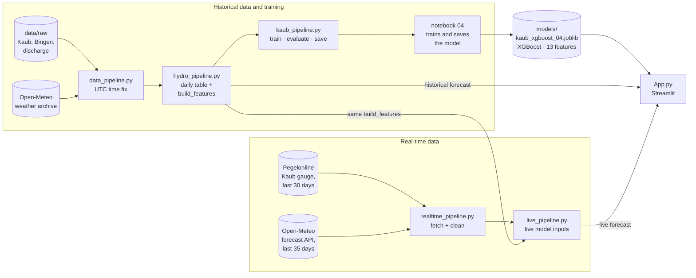

# Pipelines — HydroLoad-AI

How data flows from the raw gauge files to a 7-day water-level forecast at **Kaub**, for both
**historical** and **real-time** forecasting.

All pipeline code lives in [`modeling/`](../modeling). Commands are run from the **repository root**.

---

## 1. Overview



| Path | Steps |
|---|---|
| **Training** | raw files + weather archive → `data_pipeline` (UTC fix) → `hydro_pipeline` (daily table, `build_features`) → `kaub_pipeline` (train, evaluate) → **notebook 04 (pipeline)** saves `models/kaub_xgboost_04.joblib` |
| **Historical forecast** | `App.py` → `hydro_pipeline.load_hydro_daily()` + `build_features()` → saved model |
| **Real-time forecast** | `App.py` → `live_pipeline`: `realtime_pipeline` fetches Pegelonline + Open-Meteo → `build_features()` → latest day → saved model |

The key design rule: **`hydro_pipeline.build_features()` is the only feature function.** Training,
historical forecasts and live forecasts all use it, so the model always gets inputs prepared the
same way (see [section 7](#7-are-training-historical-and-live-features-the-same)). Only the data
*before* the features differs: historical data comes from the raw files and the weather archive,
live data from Pegelonline and the Open-Meteo forecast API.

---

## 2. The five pipelines

| File | Purpose | Main functions | Used by |
|---|---|---|---|
| [`data_pipeline.py`](../modeling/data_pipeline.py) | Reads the raw Kaub gauge record and the hourly weather archive, converts both to **UTC**, joins them on the real instant. Run on its own it also writes the Kaub-only processed files, including the weather cache | `load_water_utc()`, `fetch_weather_utc()`, `load_weather_utc_from_cache()`, `build()` | `hydro_pipeline.py`, notebooks 02 and 03 (through its output files) |
| [`hydro_pipeline.py`](../modeling/hydro_pipeline.py) | Builds the **historical daily table** (Kaub + Bingen + discharge + weather) and holds the **shared feature, split and evaluation code** | `build_hydro_daily()`, `load_hydro_daily()`, `build_features()`, `time_split()`, `metrics()`, `regime_table()`, `alarm_scores()` | `kaub_pipeline`, `live_pipeline`, `App.py`, notebooks 04, 05 |
| [`kaub_pipeline.py`](../modeling/kaub_pipeline.py) | **Training**: the models from the original notebook 04 — train, evaluate, save, load, predict | `load_data()`, `make_features()`, `make_models()`, `split_data()`, `train_model_groups()`, `refit_and_test()`, `train()`, `save_model()`, `load_model()`, `predict()` | notebook 04, notebook 05 |
| [`realtime_pipeline.py`](../modeling/realtime_pipeline.py) | **Live fetching**: last 30 days of water level (Pegelonline) and 35 days of daily weather (Open-Meteo forecast API), cleaned and merged | `fetch_water_data()`, `clean_water_data()`, `create_daily_water()`, `fetch_weather_data()`, `clean_weather_data()`, `merge_live_data()`, `validate_live_data()` | `live_pipeline.py` |
| [`live_pipeline.py`](../modeling/live_pipeline.py) | **Live model inputs**: fetching from `realtime_pipeline`, features from `hydro_pipeline` | `fetch_live_daily()`, `create_live_features()`, `latest_inputs()`, `live_pipeline()` | `App.py`, notebook 05 |

`realtime_pipeline.py` still contains its own `create_live_features()` and `realtime_pipeline()`
(the original feature code). `App.py` no longer calls them; they are kept so notebook 05
and `tests/test_live_pipeline.py` can prove the old and new live features are identical.

### Supporting files

| File | Purpose |
|---|---|
| [`cargo_calculation.py`](../modeling/cargo_calculation.py) | `estimate_cargo()`: forecast level → water depth, available draft, vessel cargo, truckloads |
| [`App.py`](../modeling/App.py) | Streamlit dashboard; loads the model and pipelines directly (historical: `hydro_pipeline`, live: `live_pipeline`) |
| [`archive/`](../archive) | unused files kept for reference: old app version, coffee-template code and data, old screenshots and models |

---

## 3. Settings

In `hydro_pipeline.py`:

| Setting | Value | Meaning |
|---|---|---|
| `HORIZON` | `7` | forecast 7 days ahead |
| `TEST_YEARS` | `3` | last 3 years of data = test set |
| `VAL_YEARS` | `2` | last 2 years of the training data = validation set |
| `LOW_WATER_CM` | `77` | low-water alarm when the forecast is **below** 77 cm |

`LOW_WATER_CM` is the default for the pipelines and notebooks 04–05. The Streamlit app has its own
**"Low-water threshold"** setting in the sidebar (default 77 cm) that the user can change.

**Saved model:** `models/kaub_xgboost_04.joblib` (`kaub_pipeline.MODEL_PATH`), a dictionary with
`model`, `features` and `horizon`. The Streamlit app loads this file; it is committed to git.

---

## 4. Features

Created by `hydro_pipeline.build_features(daily)` on a **complete daily calendar**, so
`lag_7` always means *seven calendar days ago*; a missing day gives `NaN` instead of a wrong value.
Level, rain and temperature are rounded to whole numbers first (`round_inputs=True`), as in notebook 04.

| Group | Features |
|---|---|
| Kaub level history | `lag_0` (today), `lag_1` … `lag_7`, `lag_14`, `lag_21`, `lag_28` |
| Kaub trend | `level_change_1d/3d/7d/14d`, `level_min_7d`, `level_max_7d`, `level_mean_30d` |
| Rainfall | `precip_3d`, `precip_7d`, `precip_14d`, `precip_30d`, `precip_60d`, `precip_90d` |
| Temperature | `temp_3d`, `temp_7d` |
| Snow / evaporation | `snow_30d`, `et0_30d` *(history only)* |
| Upstream | `bingen_lag_1/2/3/7`, `discharge_lag_1/2/3/7`, `discharge_change_1d` *(history only)* |
| Season | `doy_sin`, `doy_cos` |
| Targets | `target_day_1` … `target_day_7`, `target` (= 7 days ahead) |

Features marked *history only* are created only when their source columns exist; live data has
just water level, rain and temperature.

**Saved model features (13):** `lag_0`, `lag_1`, `lag_2`, `lag_3`, `lag_7`, `lag_14`, `lag_28`,
`precip_3d`, `precip_7d`, `precip_14d`, `precip_30d`, `temp_3d`, `temp_7d`
(feature group *"Kaub + precipitation + temperature"*). All 13 can be built from live data.

---

## 5. Historical forecasting

Uses the 26-year record in `data/raw/`.

### Step 1 — build the daily data (only when raw data changes)

```bash
uv run python -m modeling.hydro_pipeline
```

```
data/raw/*.csv ──► data_pipeline (UTC fix) ──► hydro_pipeline.build_hydro_daily()
                                            ──► data/processed/kaub_hydro_weather_daily.csv
```

Weather is read from the cached `data/processed/kaub_weather_hourly.csv`. That cache is written by
`uv run python -m modeling.data_pipeline`, which **re-downloads 26 years of weather**;
add `--offline` to reuse the existing cache instead.

### Step 2 — train, evaluate and save the model

There are **two ways**, and they save **different models to the same file**:

| Way | Model trained on | Validation MAE | Test MAE |
|---|---|---|---|
| **Notebook 04 (pipeline)**, section "Save Model for streamlit" | `train_fit` (2000 → Aug 2021) | 43.5 cm | 47.6 cm |
| `uv run python -m modeling.kaub_pipeline` | `train` (2000 → Aug 2023) | 43.5 cm *(checked before refitting)* | 47.2 cm |

**The model currently saved and used by the app is the notebook 04 (pipeline) version** (XGBoost on
`train_fit`). Running `modeling.kaub_pipeline` replaces it with the version trained up to 2023;
undo with `git restore models/kaub_xgboost_04.joblib`.

```
kaub_pipeline.load_data() ─► make_features() ─► split_data() ─► train XGBoost ─► save_model()
                             (= build_features)                                ─► models/kaub_xgboost_04.joblib
```

Split (with 7-day gaps so no target overlaps the next period):

| Part | Dates |
|---|---|
| `train_fit` | 2000-01-30 → 2021-08-18 |
| `validation` | 2021-08-26 → 2023-08-25 |
| `train` (= train_fit + validation) | 2000-01-30 → 2023-08-25 |
| `test` | 2023-09-02 → 2026-08-25 |

### Step 3 — forecast from a past date

| Where | How |
|---|---|
| Notebook 04 (pipeline) | `kp.predict(kp.load_model(), kp.load_data())` |
| `App.py` | "Historical forecast" → `load_features()` → `hydro_pipeline.load_hydro_daily()` + `build_features()` |

Dates before August 2021 were part of the saved model's training data, so historical forecasts for
those days are not a fair test of the model.

---

## 6. Real-time forecasting

Uses live data from **Pegelonline** (Kaub gauge) and **Open-Meteo** (weather). Needs internet.

### One call

```python
from modeling.kaub_pipeline import load_model
from modeling.live_pipeline import live_pipeline

saved = load_model()
realtime, X_live = live_pipeline(saved["features"])
forecast = saved["model"].predict(X_live)[0]
```

### What happens inside

```
live_pipeline(feature_names)
 ├─ 1. fetch_live_daily()       realtime_pipeline: fetch → clean → daily → merge → validate
 │                              (last 30 days of water, 35 days of weather; incomplete days = NaN)
 ├─ 2. create_live_features()   hydro_pipeline.build_features()  ← same as training
 └─ 3. latest_inputs()          latest complete day; stops if any needed history is missing
```

| Where | How |
|---|---|
| Notebook 05 (pipeline) | step by step, plus a check that live features = training features |
| `App.py` | "Update live forecast" button → `live_pipeline()` |

> The older version, `notebooks/archive/05_Real_time_data.ipynb`, defines its own copy of every function instead of using the pipeline.

---

## 7. Are training, historical and live features the same?

**The feature code is the same everywhere.** Every path calls `hydro_pipeline.build_features()`:

| Use | Function | Calls `build_features()` |
|---|---|---|
| Training (notebook 04, `kaub_pipeline`) | `kaub_pipeline.make_features()` | ✅ |
| Historical forecast (`App.py`) | `load_features()` | ✅ |
| Live forecast (`App.py`, notebook 05) | `live_pipeline.create_live_features()` | ✅ |

This was checked:

- Retraining the XGBoost exactly like notebook 04 (pipeline) with today's `build_features()` gives
  **identical predictions** to the saved model on all 9,712 forecastable days.
- On the same input, live features = training features = the original `realtime_pipeline`
  features (`tests/test_live_pipeline.py`, notebook 05).

**What differs is the data before the features**, because past and live data come from different sources:

| | Historical | Real-time |
|---|---|---|
| Water level | raw WSV files, 15-min | Pegelonline API, 15-min (same Kaub gauge) |
| Weather | Open-Meteo **archive**: hourly, summed/averaged per day | Open-Meteo **forecast API**: ready-made daily values |
| Daily averaging | hourly on UTC, grouped by German calendar day | hourly in German time, then daily |
| Incomplete days | kept (only one in 26 years) | set to `NaN`, so the forecast stops if they are needed |
| History | 26 years | 30 days of water level |
| Extra columns | Bingen, discharge, snow, evaporation | none (only level, rain, temperature) |

The weather source is the one real risk: live rain and temperature values can differ slightly from
what the archive (used for training) would report for the same day.

---

## 8. Streamlit app

```bash
uv run streamlit run modeling/App.py          # http://localhost:8501
```

| Sidebar setting | What it does |
|---|---|
| **Data source** | *Live forecast* (button "Update live forecast" → `live_pipeline`) or *Historical forecast* (date picker → `hydro_pipeline`) |
| **Low-water threshold** | default 77 cm; the status card turns red when the forecast is below it |
| **Cargo planning** | requested cargo and vessel assumptions for `cargo_calculation.estimate_cargo()` |

The dashboard shows the observed level, the 7-day forecast, available draft, cargo by vessel,
the low-water status, a chart of recent levels with the forecast, cargo planning (vessel load,
remaining cargo, truckloads), the Kaub gauge on a map, the model inputs and the feature importance.

---

## 9. Notebooks

Run notebooks from the `notebooks/` folder.

| Notebook | Uses the pipeline? | Content |
|---|---|---|
| `00. data_import.ipynb` | No | personal copy, git-ignored (not on GitHub) |
| `01_data.ipynb` | No | data import and first exploration; ⚠️ its `to_csv` cells overwrite files in `data/processed/` |
| `02_eda.ipynb` | No | daily EDA |
| `03_baseline_model.ipynb` | No | persistence vs linear AR baseline |
| `archive/04_eda_and_multivariate_main.ipynb` | No | **archived**: original multivariate analysis, everything written in the cells (replaced by `04_eda_and_multivariate_pipeline`) |
| `archive/05_Real_time_data.ipynb` | No | **archived**: original live forecast, own copy of the functions (replaced by `05_Real_time_pipeline`) |
| `04_eda_and_multivariate_pipeline.ipynb` | **Yes** | the original notebook 04 rebuilt with `hydro_pipeline` + `kaub_pipeline`; **saves the model the apps use** |
| `05_Real_time_pipeline.ipynb` | **Yes** | live forecast with `live_pipeline` |

---

## 10. Tests

```bash
uv run python -m pytest
```

| File | Checks |
|---|---|
| `tests/test_data_pipeline.py` | the repeated autumn hour maps to two UTC instants, the spring-forward gap leaves no empty hour, weather cache round-trips, `hours_expected` follows summer time (23/24/25 h), days are grouped by German calendar day |
| `tests/test_hydro_pipeline.py` | lags and targets use calendar days, a missing day gives `NaN`, gaps in the index are rejected, incomplete days are masked against `hours_expected`, the 7-day split gaps hold, alarm scores, `kaub_pipeline.predict()` dates |
| `tests/test_live_pipeline.py` | live features = training features = old realtime features, no target columns in live data, the latest day is used, missing history or unknown features stop the forecast |

---


